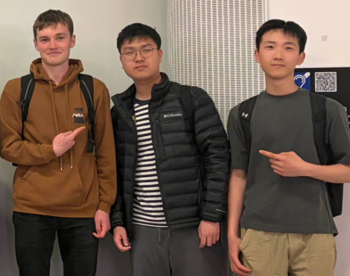
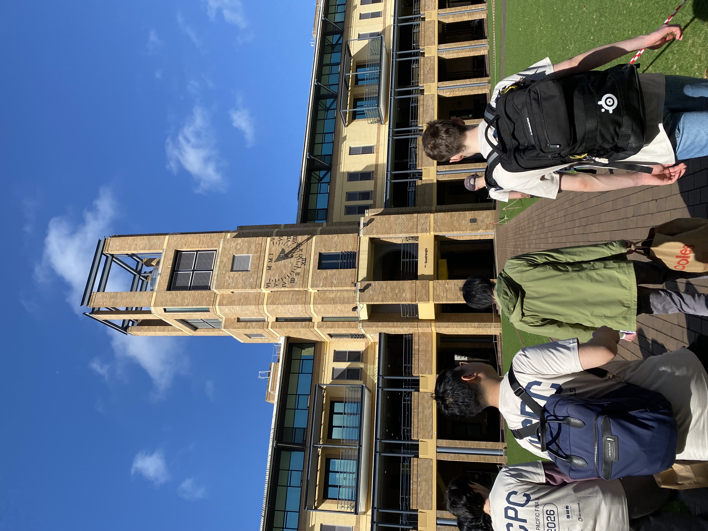
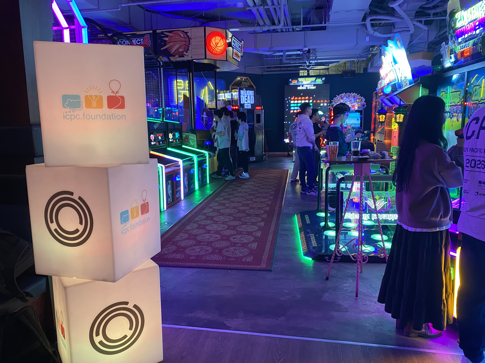
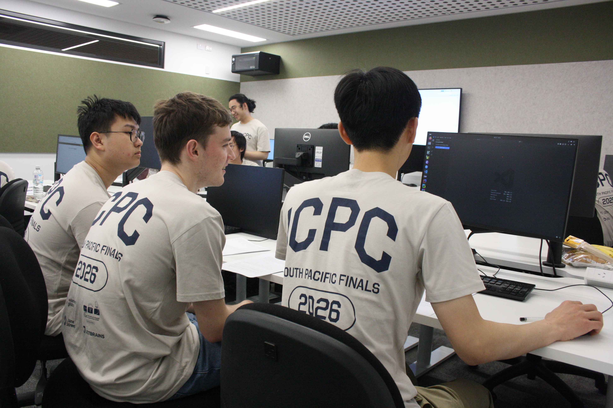
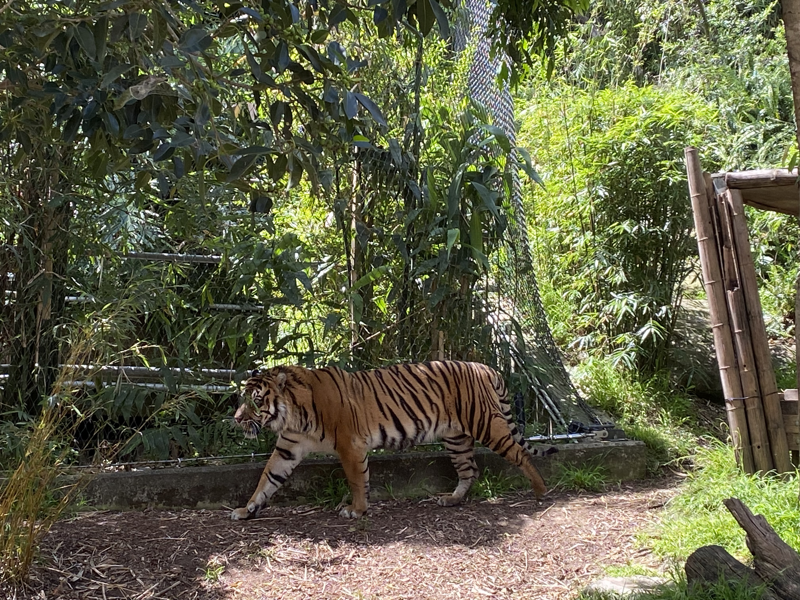

# ICPC Regional Finals 2026

This year (2026), I, along with some friends, joined MAPS (Monash Algorithms and Problem Solving) as an academy member.

This year was also the first year where I registered to compete in ICPC (International Collegiate Programming Contest), the most prestigious global team-based competitive programming competition for college/university students.

My team consisted of my friend and my friend's friend, which soon became my friend as well.

- Matt (me, on your right)
- Ian (guy in the middle)
- Pierre (guy on your left)

Surprisingly, we managed to place 11th out of 80+ teams in the preliminary finals, which would have been good enough to qualify us to regional finals as official teams, except for the fact that Monash (the uni I attend) already had 2 teams above us on the leaderboard, which actually prohibits any other Monash team from qualifying!

Fortunately, we were still invited along with a few other teams in the same situation to partake in regional finals as observer teams at UNSW, which was quite a cool experience, since we were treated as official teams.

The event took place over the weekend plus the following Monday.

## Saturday

After landing in the afternoon, we attended the opening ceremony, followed by a dinner at Archie's Brothers, fully sponsored by Jane Street and the ICPC foundation.

## Sunday

The contest was 5 hours long, from 1pm to 6pm.

Before the actual contest however, was a practice contest, which captured our team in this moment, where we were just staring at a blank screen :P.

The actual contest itself was pretty rough. I managed to solve two problems in the first 1-2 hours, and none more after that :').

However, we did manage to achieve our goal of zero wrong submissions for the problems we solved!

## Monday

The organisers took us on a trip across the bay to Taronga Zoo, which was pretty cool! - despite the 30 degree weather.

## Recap

Hopefully, next year we can make it to regional finals again, and maybe even as an official team 👀!
