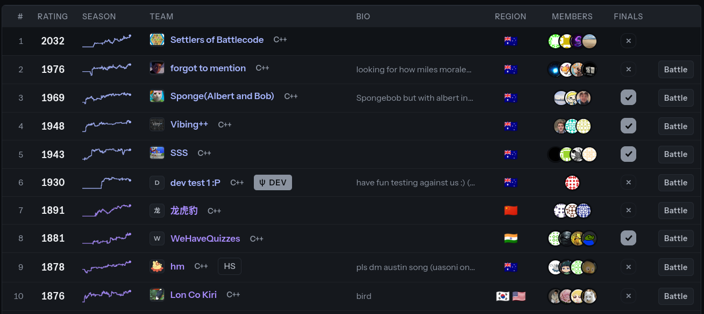
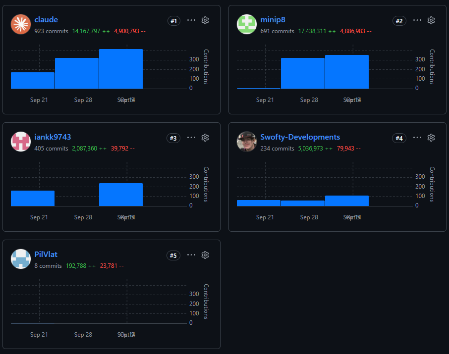

# UNSW Battlecode 2026

This year, UNSW hosted their first [Battlecode](https://game.battlecode.au)!

I teamed up with some friends from university to compete in our first Battlecode, entering as team `Settlers of Battlecode`.

## Game Overview

The game consists of controlling dragons, which moves just like snakes, with a twist - they have the ability to split their body, spawning a child!

Dragons can also [sprint](https://game.battlecode.au/docs/movement#sprinting-3), and send [sonar](https://game.battlecode.au/docs/sonar) to communicate with other dragons.

There is also a queen, who we want to protect.

To win, our dragons must either eliminate all enemy dragons, or have the longest queen. If both queens are dead, then the winner is decided on longest dragon, with total dragon length as a tie breaker.

Noticeably, dragons do not share a process - that is, each dragon is running its own process. Children who split off from their parents are also a new process, hence does not have any memory from their parent.

These twists make the game fairly interesting, and open up a variety of strategies...

[Here](https://game.battlecode.au/docs/overview) is the full documentation.

## Our Experience

Being our first time participating in a battlecode, we were fairly naive, and decided it would be a good idea to try think of all the edge cases ourselves.

We used a state machine with a set of conditions for each transition between states, which was slowly refined over time by watching way too many replays.

This approach worked well at the start...

Unfortunately, we slowly fell off from the top 10 page, down into the 30s.

Here, we decided to try some form of machine learning. Unfortunately, we are not data scientists and here we realised Claude is not a magical weapon to think of ingenious ideas. Also we ran into some problems regarding our compute allocation which I'd rather not talk about here. :)

So, after that failure, we went back to the traditional route of watching replays, questioning the dragons' behaviours, telling Claude to fix it overnight, and repeat. One of my teammates also had Claude running on a 24/7 loop for a few days which surprisingly brought us back to the edge of the top 10. (I myself do not have that many credits though)

In the final days before submissions closed, we realised we could use compute for simulating games rather than for machine learning. This way, we could test new ideas much faster, running games against our old bots to see if there was any statistically significant improvement, or if anything regressed.
This new finding instantly saw our bot have a rapid rating improvement.

Finally, the submissions for the qualifiers to the grand finals closed, and we waited to see if we qualified...

On the livestream, we were ecstatic to see that we made it to the round of 16, and we couldn't wait to see the organisers replay our game, deciding if we would make it to the round of 8, and qualify.

Unfortunately, we lost 3-4. :(

However, this experience was definitely fun, and taught us a lot.
Despite the sleepless nights and extensive Claude prompting, we now know the importance of compute, which we will definitely be using in any future Battlecodes!
(I will **not** miss my PC's whirring fan in my room while I sleep)

Final commit stats (lol):

